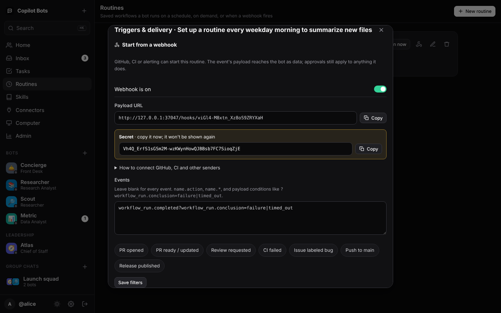
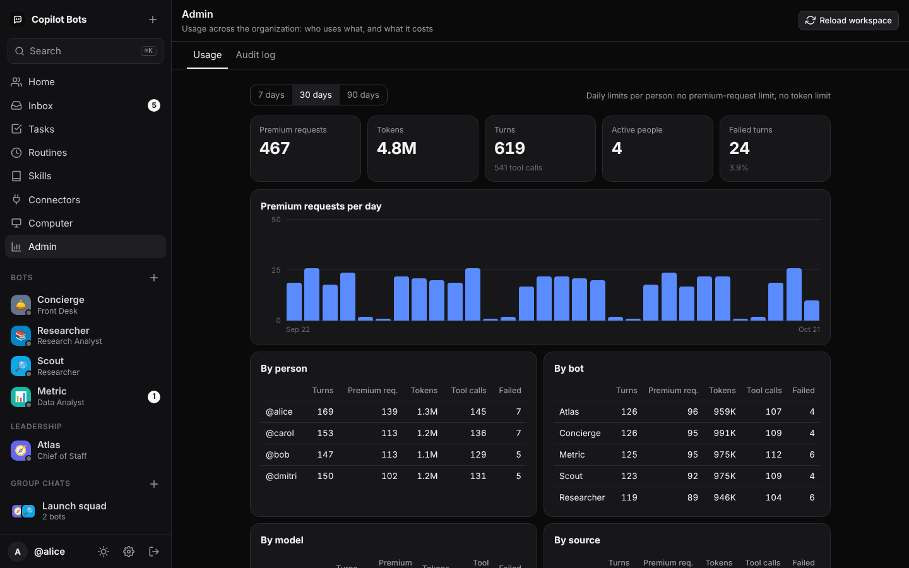

# Copilot Bots

Self-hosted **AI teammates for your organization**, modeled on xAI's
[Grok Bot](https://www.datacamp.com/blog/grok-bot) and running on the
[GitHub Copilot SDK](https://www.npmjs.com/package/@github/copilot-sdk) instead of Grok. Each person gets a
roster of named bots with job titles. You message them like coworkers. They keep working in the
background, hand work to each other, remember how you like things done, run routines on a schedule,
and ask before doing anything risky. Every turn runs **as the person asking, on their own Copilot seat**.


| | |
| --- | --- |
|  |  |
|  |  |
|  |  |
|  |  |

## Try it in 30 seconds (no Copilot seat needed)

```bash
npm install
npm run demo          # http://127.0.0.1:8080, click "Enter demo"
```

Demo mode swaps the model for a scripted engine and enables a dev sign-in. Every reply is labelled as
demo output, but everything else is real: queueing, streaming, approvals, hand-offs, memory, routines
and audit. Try "delegate …", "remember …", "run a script …" (on a Computer bot), "every weekday …", or
`@mention` in a group chat.

## Run it for real

```bash
npm run build
ADMINS=your-login ORG_NAME="Acme" npm start
```

People sign in with GitHub. Set `GITHUB_OAUTH_CLIENT_ID` / `GITHUB_OAUTH_CLIENT_SECRET` for the OAuth
button, or let them paste a token. Their token needs a Copilot seat. Add the `read:org` scope if you
share bots by org. `docker build -t copilot-bots .` gives a production image (state in `/data`).

`GITHUB_TOKEN=$(gh auth token) npm run smoke` boots the Copilot runtime and runs a real turn plus a real
bot-to-bot hop.

**Bring your own model.** To run bots on your own model endpoint instead of GitHub Copilot's models,
set `MODEL_PROVIDER` and `MODEL_PROVIDER_URL`. Endpoints can be OpenAI-compatible (an internal gateway,
vLLM, Ollama), Azure OpenAI, or Anthropic. Also set `MODEL_PROVIDER_API_KEY` and `DEFAULT_MODEL`.
Inference is then billed to that provider. Everything else stays the same, including connectors that
use the person's GitHub token.

## Parity with Grok Bot

Grok Bot's feature list comes from xAI's launch coverage:
[DataCamp](https://www.datacamp.com/blog/grok-bot), [eesel](https://www.eesel.ai/blog/grok-bot),
[unite.ai](https://www.unite.ai/xai-launches-grok-bot-always-on-ai-teammates-with-their-own-cloud-computers/),
and the [Oct 2026 grok.com notes](https://releases.sh/xai/grok.md).

| Grok Bot | Copilot Bots |
| --- | --- |
| Roster of named bots with job titles, in a sidebar "Bots" section | ✅ Sidebar roster with avatar, job title, live status (working / waiting for you), unread counts |
| Create a bot from a name, a job and a description; role templates in a tab strip | ✅ New-bot dialog with 10 role templates (Chief of Staff, Researcher, Release Manager, PR Reviewer, CI Doctor, On-call Triage, Bug Reproduction, Incident Commander, Docs Writer, Data Analyst) |
| Message it like a coworker; it keeps working when you close the app | ✅ Persistent job queue (SQLite). Bots run server-side; interrupted turns resume after a restart |
| Memory across conversations (user, bot) | ✅ `remember` / `forget` tools; user-level and per-bot memory, editable in Settings |
| Bots message each other, share group chats (2–6), and hand off ownership | ✅ `ask_bot` (sync), `assign_task` (async, own task thread, result posted back and the requester woken), group chats of 2–6 with `@mention` hand-offs |
| Teach a task once → draft skill → review → reuse on any bot | ✅ "Teach a skill" turns a thread into a draft `SKILL.md` you edit and publish; skills attach to any bot |
| Routines: one workflow for one bot, scheduled, 50 per bot, 20 runs kept | ✅ Same limits; cron + time zone, run now, run history, bots can create routines from chat |
| Bots return to you when a human decision is needed; approval settings | ✅ Per-bot allow / ask / deny policy. Inline approval cards and Inbox with Approve / Deny / Always allow; the bot pauses until you decide (timeout → expired) |
| Connectors, with reconnect for expired sign-ins | ✅ MCP connectors; per-user credentials encrypted at rest; Connect / Reconnect / Disconnect |
| Shared cloud computer (files, terminal, browser) across your bots | ✅ Per-user workspace shared by your bots: file tools confined to it, shell (approval-gated, opt-in per deployment), a Playwright browser connector with a persistent profile, and a file browser with upload/download. Off by default; see [Security model](#security-model) |
| Bot organization: sidebar sections | ✅ Per-user sections and hide/show for any bot, so a large org catalog stays manageable |
| Audit view of bot actions ("coming" at Grok) | ✅ Append-only audit log with trace IDs, plus an admin viewer |
| 50 bots + group chats per account | ✅ Same, configurable |
| Chat niceties | ✅ Streaming Markdown, tool-activity chips, reasoning view, image and file attachments (paste / drag-drop), voice dictation, read-aloud, ⌘K search, share links, Markdown export, desktop notifications, paged history, catch-up after reconnects, dark / light, mobile layout |

Beyond Grok Bot, because this is for enterprises:

- **Your identity, not a service account.** Copilot runs with each user's token (`gitHubTokenProvider`),
  so seat checks, model policy, content exclusions and billing apply per person. Connectors can forward
  the same token (`${user.githubToken}`).
- **Bots as code.** Org bots, connectors and skills live in `workspace/` as reviewed YAML and `SKILL.md`,
  validated at load time. People also create personal bots in the UI.
- **Least privilege.** The Copilot client runs in `mode: "empty"`. Bots get only the built-ins they opt
  into, and every permission request goes through a deny-by-default policy.
- **Guardrails on bot-to-bot traffic.** An allowlist (`canMessage`), a hop limit, cycle refusal (also
  for `@mention` ping-pong in groups), and a per-request call budget.
- **Prompt-injection hygiene.** Tool output and other bots' messages are marked as data, and bot
  messages carry `source: "agent-<id>"`. The usual exfiltration channels are closed (see below).
- **Data rights.** "Delete my data" removes everything stored for a person except the audit trail.

## For engineering teams

Bots are most useful when they're wired into the tools a team already uses. These features close the
loop between the platform and GitHub, CI, chat and billing.

**Webhook-triggered routines.** Any routine can be started by a webhook (GitHub, CI, alerting). In
*Routines → Triggers & delivery*, turn the webhook on, then paste its URL and secret into GitHub's
*Settings → Webhooks*. Filters choose which events run it:

```text
pull_request.opened                                        # new PRs → PR Reviewer
workflow_run.completed?workflow_run.conclusion=failure|timed_out   # red CI → CI Doctor
issues.labeled?label.name=bug                             # bug triage
```

GitHub's `X-Hub-Signature-256` is verified in constant time. Senders that can't sign send
`Authorization: Bearer <secret>` and name the event with `X-Event-Type`. Redeliveries with the same
delivery id run once, and `ping` is answered without a run. The payload reaches the bot compacted:
API URLs, node ids and nested repository objects are dropped, and people become their login. It is
JSON-encoded inside a fenced block labelled as data, so text in a PR body can't pose as instructions.
Runs still execute as the routine's owner, under their approvals and budget.

**Results posted to Slack or Teams.** Each run's result (or failure) can be posted to a Slack incoming
webhook, a Microsoft Teams workflow (as an Adaptive Card) or any JSON endpoint. The URL is sealed at
rest and only its host is ever shown. It must be https and pass the SSRF guard, both when saved and
when sent, and redirects aren't followed. Bot output is escaped so it can't `@channel` anyone.

**API tokens and `copilot-bots ask` for CI.** Under *Settings → API tokens*, create a token with
scopes `ask`, `read` and/or `write`:
- `ask` covers one-shot asks, running routines and reading their results.
- No scope can manage tokens, delete the account, touch credentials or reach admin endpoints.
- Tokens are stored as hashes, expire, and stop working when the owner's GitHub sign-in does.

```yaml
# .github/workflows/review.yml
- run: git diff origin/${{ github.base_ref }}... | npx copilot-bots ask pr-reviewer "Review this diff. Most severe findings first."
  env:
    COPILOT_BOTS_URL: https://bots.example.com
    COPILOT_BOTS_TOKEN: ${{ secrets.COPILOT_BOTS_TOKEN }}
```

Here `pr-reviewer` is an org bot defined in `workspace/bots/`, so its id is stable. `POST /api/bots/<id>/ask` runs the request as a task and waits for the result (`timeoutSec`, up to 10
minutes). If the bot needs a person's approval first, it returns `202` with the task to poll. The CLI
exits with 0 when the task is done, 1 when it failed, and 3 when it is still waiting.

**Bot evals in CI.** Regression cases live next to the bots in `workspace/evals/*.yaml`, and
`copilot-bots eval --junit reports/evals.xml` runs them. A change to a bot's instructions, model,
skills or connectors is then tested like code.

```yaml
bot: concierge
cases:
  - name: answers simple questions itself
    prompt: What is 12 times 12? Reply with just the number.
    expect: { contains: ["144"], noTools: [ask_bot] }
  - name: asks before closing tickets
    prompt: Close ticket 7
    expect: { asksApproval: true }      # approvals are denied unless `approve: true`
```

Expectations can check:
- reply content: `contains`, `notContains` and `matches` (regex);
- tool use: `tools`, `noTools` (both take `prefix*`) and `maxToolCalls`;
- approvals: `asksApproval`.

Each case runs in a fresh thread through the full runtime. Approval requests are answered automatically
(denied unless the case sets `approve: true`). Evals use `EVAL_GITHUB_TOKEN` against Copilot, or no
seat at all with `MODEL_PROVIDER`.

**Usage and budgets.** Every turn records its model, model calls, tokens, Copilot premium requests,
tool calls, duration, outcome and source (chat, task, routine, API, bot-to-bot).
- People see their own usage under Settings.
- Admins see the whole organization under *Admin → Usage*: per day, person, bot, model and source.
- `DAILY_PREMIUM_REQUESTS` and `DAILY_TOKENS` cap each person per UTC day. A capped person's bots stop
  with a clear message instead of running up the bill.
- "Delete my data" keeps the usage numbers for chargeback, but removes the person's login from them.

**Engineering templates.** PR Reviewer, CI Doctor, On-call Triage, Bug Reproduction, Release Manager
and Incident Commander. Each template's tip says which webhook filter and delivery to wire it to.

Grok Bot features not reproduced: recording a screen demo to create a skill (here you teach from a
thread instead), live remote control of the agent computer for typing passwords, and model-based "Auto
Review" of approvals.

## Defining org bots, connectors and skills

```yaml
# workspace/bots/release-writer.yaml
id: release-writer
name: Release Writer
title: Release Manager
avatar: "📦"
description: Reads merged pull requests on GitHub and drafts release notes in the house format.
instructions: |
  Use the GitHub connector to read what you need. Load the release-notes skill before drafting.
model: claude-sonnet-4.5           # optional
builtinTools: [web_search, web_fetch]
skills: [release-notes]
connectors: [github]
canMessage: [researcher]           # or ["*"] for any bot the user can use
computer: false                    # shared workspace (needs COMPUTER_ACCESS on the server)
allowedDomains: [docs.github.com]  # optional: where web_fetch may go
memory: true
access: { users: ["*"], orgs: [your-org] }
permissions:                       # optional; derived from capabilities when omitted
  allow: [url, mcp, custom-tool]
  ask: [write, shell]
```

```yaml
# workspace/connectors/jira.yaml: an MCP server; each user connects their own key
id: jira
name: Jira
description: Search and read Jira issues
type: http
url: https://mcp.example.com/jira
headers: { Authorization: "Bearer ${user.credential}" }
auth: { type: secret, label: "Jira API token" }
```

Connector policy fields:

```yaml
access: { users: [], orgs: [platform-team] }  # who may add it to personal bots
requireApproval: writes        # writes (default) | always | never
allowTools: ["search_*", "get_*"]  # never ask for these
```

Connectors that embed an org secret (`${env:...}`) are unavailable to personal bots unless `access`
grants them. Placeholders: `${user.githubToken}`, `${user.login}`, `${user.credential}`, `${user.computerDir}` and
`${env:NAME}`. They are resolved per session and redacted from the audit log. Skills are standard
`SKILL.md` folders. `npm run validate` checks the whole workspace.

## Architecture

```
browser ──HTTP/SSE──▶ http/server.ts ──▶ runtime/runtime.ts ──▶ engine/copilot.ts ──▶ Copilot runtime
 (web/*.js)            auth, CSRF,         threads, job queue,     bot → SessionConfig     (mode "empty",
                       REST, uploads       approvals, tasks,       (tools, MCP, skills,     one session per
                                           memory, routines        token provider)          bot per thread)
                                                │
                                   store/db.ts (node:sqlite) · audit.ts (JSONL)
```

A post into a thread enqueues a `wake` job for each addressed bot. A worker pool (`CONCURRENCY`) runs at
most one turn per bot per thread. The bot reads everything new since its cursor, replies, and may wake
others through `@mentions` and task results. Approvals block only that bot's turn. Routines are cron
jobs that post into a routine thread.

| Setting | Default | |
| --- | --- | --- |
| `ENGINE` | `copilot` | `demo` for the scripted engine |
| `PORT`, `HOST`, `PUBLIC_URL` | `8080`, `127.0.0.1` | `PUBLIC_URL` (https) turns on secure cookies |
| `WORKSPACE_DIR`, `STATE_DIR` | `./workspace`, `./state` | |
| `ADMINS`, `ORG_NAME`, `DEFAULT_MODEL` | | |
| `GITHUB_OAUTH_CLIENT_ID`, `GITHUB_OAUTH_CLIENT_SECRET`, `GITHUB_OAUTH_SCOPE` | | OAuth sign-in |
| `GITHUB_API_URL`, `GITHUB_WEB_URL` | github.com | GitHub Enterprise Server |
| `SECRET_KEY` | generated in `STATE_DIR` | base64 32 bytes; seals tokens and credentials |
| `MAX_HOPS`, `MAX_BOT_CALLS`, `CONCURRENCY`, `MAX_PER_USER` | `3`, `12`, `4`, `2` | `MAX_PER_USER` keeps one person from starving others |
| `COMPUTER_ACCESS` | `off` | `files` (file tools confined to each user's workspace) or `shell` |
| `ALLOW_PRIVATE_NETWORK` | off | turn off the platform's own private-address guard (the Copilot runtime keeps its own) |
| `MODEL_PROVIDER`, `MODEL_PROVIDER_URL`, `MODEL_PROVIDER_API_KEY`, `MODEL_PROVIDER_WIRE_API` | | bring your own model: `openai`, `azure` or `anthropic` |
| `COMPUTER_SHELL_ISOLATED` | off | required with `COMPUTER_ACCESS=shell`: confirms each user's runtime is isolated |
| `SECRET_KEY_PREVIOUS` | | old key during a rotation (`copilot-bots rotate-key`) |
| `SHARE_TTL_DAYS`, `MAX_STORAGE_MB` | `30`, `1024` | share-link lifetime; per-user upload storage |
| `TURN_TIMEOUT_MS`, `APPROVAL_TIMEOUT_MS` | 10 min, 30 min | |
| `DAILY_PREMIUM_REQUESTS`, `DAILY_TOKENS` | `0` (no limit) | per-person daily budgets, reset at 00:00 UTC |
| `USAGE_RETENTION_DAYS` | `400` | how long usage records are kept |
| `EVAL_GITHUB_TOKEN` | | `copilot-bots eval`: whose Copilot seat and connectors the evals use |
| `DEV_LOGIN` | off | demo only; refused with `ENGINE=copilot` |

## Security model

The Copilot runtime's tools run on the platform host. The platform therefore treats every bot as
untrusted (bots read untrusted content and can be prompt-injected), and narrows what they can do:

| Threat | Control |
| --- | --- |
| A bot reads host files (other users' data, `secret.key`, the DB) | No computer unless `COMPUTER_ACCESS` allows it. Every read/write path, after resolving symlinks, must be inside that user's workspace or it is refused. Missing paths are refused. |
| A bot runs arbitrary commands | Shell only with `COMPUTER_ACCESS=shell`, and each command asks the user unless they chose "always allow" for their own bot. Enable it only where each user's runtime is isolated. |
| SSRF to cloud metadata or internal services | Two independent layers, both tested against the real runtime. The platform resolves each `web_fetch` URL at the permission request and refuses (and audits) any loopback, private, link-local, CGNAT or multicast address. Separately, the Copilot runtime refuses the same ranges when it connects, which also defeats DNS rebinding. Per-bot `allowedDomains` narrows further. The stdio connectors you configure (such as the browser) have no such guard, so restrict their egress at the network layer. |
| Exfiltration through rendered output | Remote images in bot Markdown are never loaded (rewritten during sanitizing, and blocked by `img-src 'self'`). The E2E run asserts the browser makes no off-origin requests at all. |
| Connector write actions | Non-read-only MCP tools ask the user by default (`requireApproval`). |
| Shared org credentials | Connectors with `${env:...}` secrets are org-bot-only unless granted. |
| Stale access | Cookie sessions re-check the token with GitHub (5-minute cache), and background work re-checks token and org membership before running as someone. |
| Bot-to-bot loops and runaway cost | Allowlists, cycle refusal, hop limit, per-request budget, per-user concurrency and queue caps. |
| Platform secrets reaching bots | The Copilot runtime (and every shell command and stdio connector it starts) gets an allowlisted environment: no `SECRET_KEY`, OAuth secret or server `GITHUB_TOKEN`. Connector secrets reach only their own MCP server, through `env`/`headers`; the catalog rejects secrets in command-line args or URLs. |
| Prompt-injection persistence | Routines a bot proposes are saved switched off until the user enables them; schedules can't fire more than every 15 minutes. Memory written by bots is stored as one plain line, labelled with its author, and presented to bots as data, never instructions. |
| One approval becoming permanent | "Always allow" exists only for workspace-confined file access and SSRF-guarded URLs on your own bots; shell commands and connector writes are approved one at a time. |
| Browser attacks on the app | Strict CSP (no inline script or style), Trusted Types (only DOMPurify output reaches an HTML sink), `X-Frame-Options`, COOP/CORP, `nosniff`, no-store API responses, HSTS over HTTPS. Cookie writes need `X-CSRF` and a same-origin `Origin`. |
| Uploaded content | Only images and plain text render inline; everything else downloads as `application/octet-stream` under a sandbox CSP. Per-user storage quota (`MAX_STORAGE_MB`). |
| Brute force and abuse | Per-IP sign-in rate limit, per-user API and message rate limits, a cap on open event streams, per-user concurrency and queue caps. |
| Share links | Stored as hashes, expire after `SHARE_TTL_DAYS`, and show only the conversation (no approvals, tool arguments, attachments or ids). |
| Unsafe configurations | Startup refuses `DEV_LOGIN` off localhost, shell mode without `COMPUTER_SHELL_ISOLATED=1`, and OAuth without `PUBLIC_URL`. |
| Secrets at rest / in logs | Tokens and credentials are sealed with AES-256-GCM in a 0700 state directory; `SECRET_KEY_PREVIOUS` + `copilot-bots rotate-key` rotate the key. Known secrets are redacted from the audit log and error logs. |
| Forged or replayed webhooks | HMAC (`X-Hub-Signature-256`) or bearer secret, compared in constant time. Unknown hooks and bad signatures get the same 401. Delivery ids are deduplicated for 7 days. Secrets are sealed at rest, shown once, and rotatable. Deliveries are rate-limited per hook and per IP, capped at 2 MB, and refused when the owner's queue is full. |
| Webhook payloads steering the bot | The payload is compacted, JSON-encoded inside a fence whose delimiters it can't contain, and labelled as data. The run has only the owner's bot policy, so approvals still gate writes, shell and connector actions. |
| Result delivery as an SSRF or exfiltration channel | https only, with no credentials in the URL. The private-address guard runs at save and at send, redirects aren't followed, there's a 10 s timeout, and the response is never read back into the bot. Webhook URLs are sealed and redacted from logs. Slack mentions in bot output are escaped. |
| Leaked API tokens | Hashed at rest (`cbp_` prefix, so secret scanners can find them) and scoped. They expire, can be revoked, and die with the owner's GitHub sign-in. They can't mint tokens, delete the account, set credentials or use admin endpoints, and `ask` can't read conversations. Long-polling asks are capped per person. |
| Runaway spend | Per-person daily premium-request and token budgets, checked before every turn (chat, tasks, routines, webhooks, API and bot-to-bot). Every model call is metered for the admin view. |
| Audit integrity | Each audit record is hash-chained to the previous one, across days; `copilot-bots verify-audit` detects edited, removed or reordered records and deleted days. |

## Tests

```bash
npm test          # 131 tests: unit, HTTP, and the real Copilot runtime (below)
npm run e2e       # drives Chromium through every screen in demo mode → ./screenshots
npm run typecheck # against the SDK's shipped .d.ts
```

`test/real-runtime.test.ts` drives the **real Copilot runtime binary** through the platform. Only the
model is replaced, by a scripted OpenAI-compatible server (`test/support/fake-model.ts`) plugged in as a
BYOK provider. So tool exposure, the runtime's own permission requests, built-in file, shell and web
tools, real MCP servers (`test/support/fake-mcp.mjs`), skills, streaming, resumed history, approvals
and Stop are all exercised for real. The tests also assert exactly what reaches the model: the system
prompt and the tool list.

The E2E run fails on any console error (including CSP violations), horizontal overflow at phone width,
any off-origin request, or Trusted Types not being enforced. The security suites were checked by
mutation: removing each guard makes a test fail.

## Known limits

- **Copilot-hosted models are the one path not run here.** The real-runtime tests use a BYOK provider,
  because this repository's CI has no Copilot seat. Turns on GitHub's models differ only in
  authentication (`gitHubTokenProvider`) and in the `web_search` tool, which needs Copilot.
  `GITHUB_TOKEN=... npm run smoke` covers both.
- **Tool names depend on the model family.** The runtime offers GPT-5 `create`/`edit`/`grep`, GPT-4o
  `apply_patch`/`rg`, and Claude `str_replace_editor`. The platform allows all of them, and the
  permission policy, not the tool name, decides what runs.
- **Rate limits are per process and see the socket address.** Behind a reverse proxy every client
  shares the proxy's IP for the sign-in limiter, so put per-client limits at the proxy as well.
- **Audit chain:** the chain proves records weren't edited in place. Someone who can rewrite the whole
  log could rebuild it, so ship records to write-once storage or a SIEM as they're written.
- **Sandboxing:** the Computer's shell and stdio connectors run inside the server's container. Use one
  container per trust boundary, or connect to a sandboxed Copilot runtime with
  `RuntimeConnection.forUri`.
- **Single node:** SQLite plus local Copilot session state. Use sticky routing, or move session state to
  the SDK's `sessionFs` provider, before scaling out.
- **Tokens:** routines run with the user's last-seen token. When it expires, the run fails and the user
  is notified; they need to sign in again.
- **Model judgement is yours to test.** The scripted model proves the plumbing, not whether a real model
  picks the right tool or teammate. Write evals (`workspace/evals/`) for the behaviour you rely on and
  run them in CI against your model.
- **Bearer-secret webhooks can be replayed** by anyone who captured a request, unless the sender
  includes a delivery id (`Idempotency-Key`, `X-Request-Id`). Prefer signed GitHub-style deliveries.
- **Delivery DNS:** the SSRF check on result delivery resolves the host before the request, so DNS
  rebinding between the two isn't prevented. Restrict egress at the network layer if that matters.

See [docs/PROMPT.md](docs/PROMPT.md) for the refined spec this was built from.
