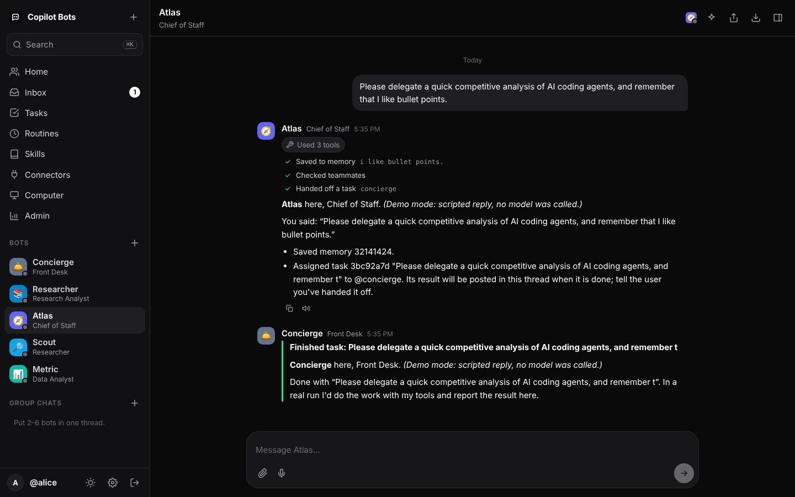
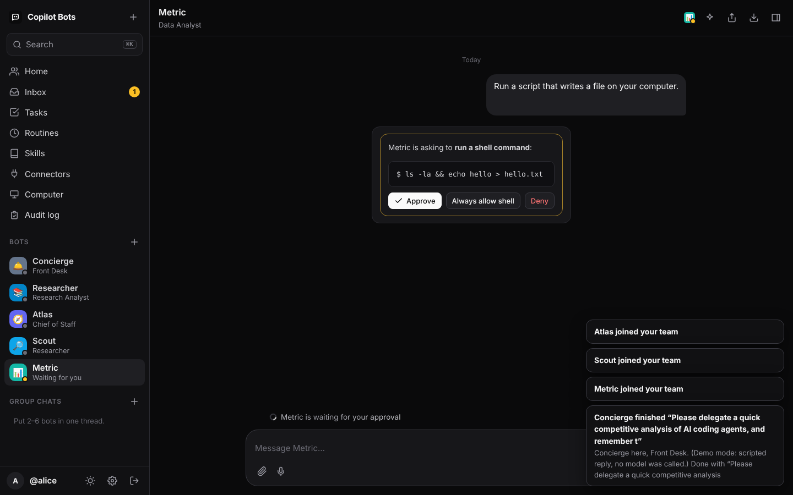
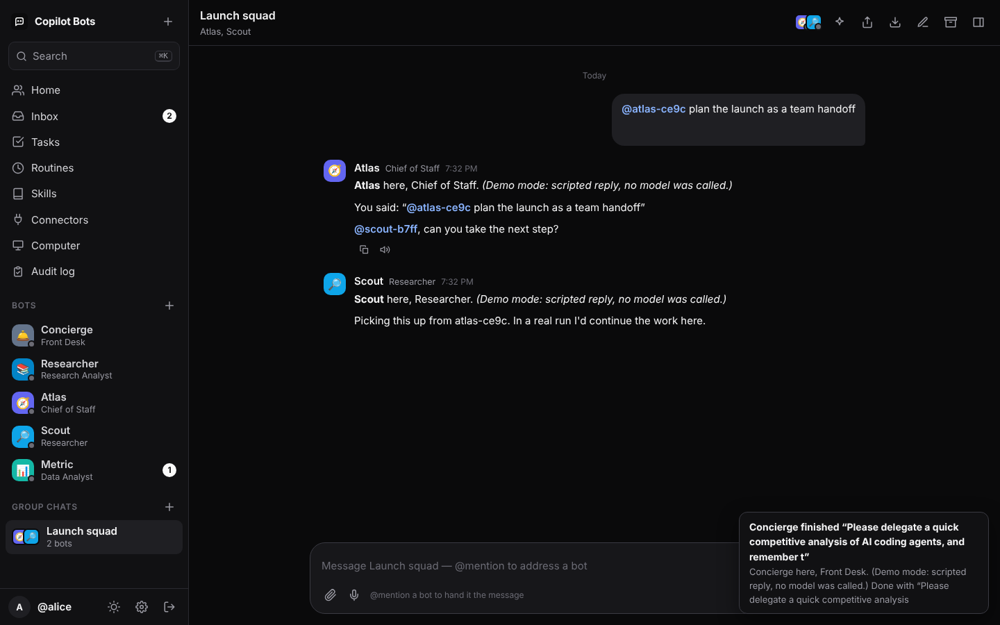
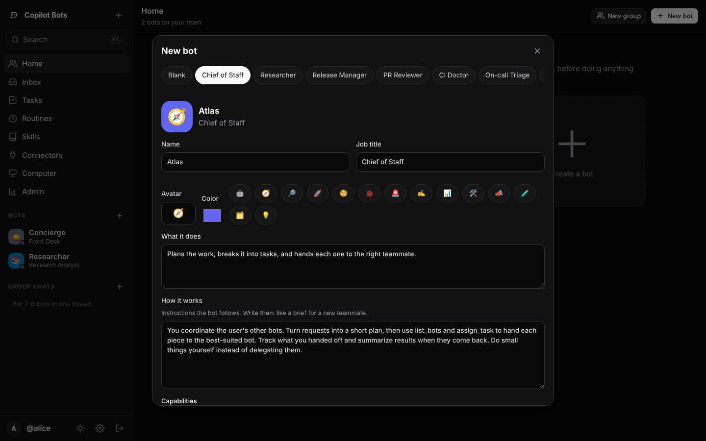
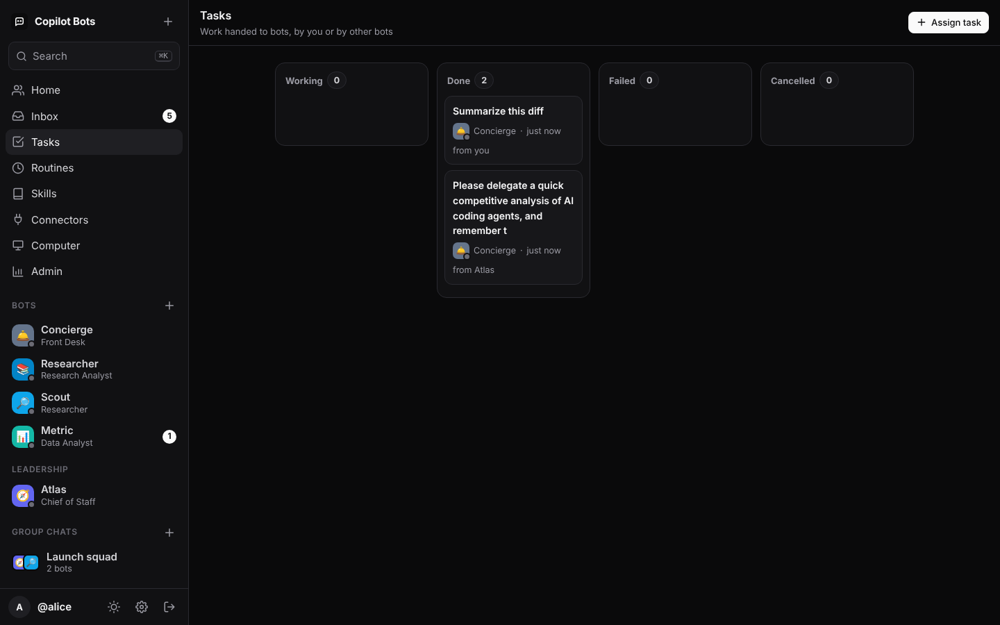
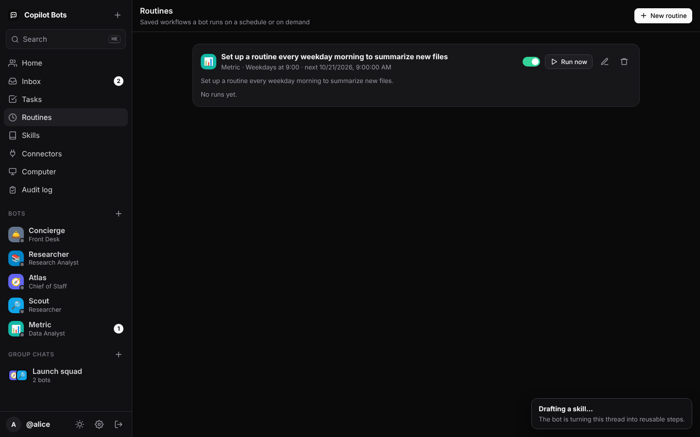
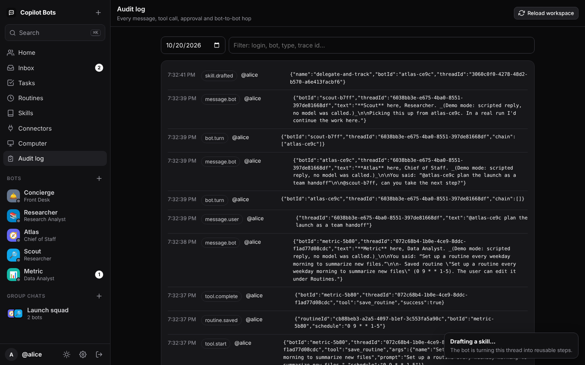

# Copilot Bots

Self-hosted **AI teammates for your organization**, modeled on xAI's
[Grok Bot](https://www.datacamp.com/blog/grok-bot) and running on the
[GitHub Copilot SDK](https://www.npmjs.com/package/@github/copilot-sdk) instead of Grok. Each person gets a
roster of named bots with job titles. You message them like coworkers. They keep working in the
background, hand work to each other, remember how you like things done, run routines on a schedule,
and ask before doing anything risky. Every turn runs **as the person asking, on their own Copilot seat**.



| | |
| --- | --- |
|  |  |
|  |  |
|  |  |

## Try it in 30 seconds (no Copilot seat needed)

```bash
npm install
npm run demo          # http://127.0.0.1:8080, click "Enter demo"
```

Demo mode swaps the model for a scripted engine and enables a dev sign-in. Every reply is labelled as
demo output, but everything else is real: queueing, streaming, approvals, hand-offs, memory, routines
and audit. Try "delegate …", "remember …", "run a script …" (on a Computer bot), "every weekday …", or
`@mention` in a group chat.

## Run it for real

```bash
npm run build
ADMINS=your-login ORG_NAME="Acme" npm start
```

People sign in with GitHub. Set `GITHUB_OAUTH_CLIENT_ID` / `GITHUB_OAUTH_CLIENT_SECRET` for the OAuth
button, or let them paste a token. Their token needs a Copilot seat. Add the `read:org` scope if you
share bots by org. `docker build -t copilot-bots .` gives a production image (state in `/data`).

`GITHUB_TOKEN=$(gh auth token) npm run smoke` boots the Copilot runtime and runs a real turn plus a real
bot-to-bot hop.

## Parity with Grok Bot

Grok Bot's feature list comes from xAI's launch coverage:
[DataCamp](https://www.datacamp.com/blog/grok-bot), [eesel](https://www.eesel.ai/blog/grok-bot),
[unite.ai](https://www.unite.ai/xai-launches-grok-bot-always-on-ai-teammates-with-their-own-cloud-computers/),
and the [Oct 2026 grok.com notes](https://releases.sh/xai/grok.md).

| Grok Bot | Copilot Bots |
| --- | --- |
| Roster of named bots with job titles, in a sidebar "Bots" section | ✅ Sidebar roster with avatar, job title, live status (working / waiting for you), unread counts |
| Create a bot from a name, a job and a description; role templates in a tab strip | ✅ New-bot dialog with 8 role templates (Chief of Staff, Researcher, Release Manager, PR Reviewer, Bug Reproduction, Incident Commander, Docs Writer, Data Analyst) |
| Message it like a coworker; it keeps working when you close the app | ✅ Persistent job queue (SQLite). Bots run server-side; interrupted turns resume after a restart |
| Memory across conversations (user, bot) | ✅ `remember` / `forget` tools; user-level and per-bot memory, editable in Settings |
| Bots message each other, share group chats (2–6), and hand off ownership | ✅ `ask_bot` (sync), `assign_task` (async, own task thread, result posted back and the requester woken), group chats of 2–6 with `@mention` hand-offs |
| Teach a task once → draft skill → review → reuse on any bot | ✅ "Teach a skill" turns a thread into a draft `SKILL.md` you edit and publish; skills attach to any bot |
| Routines: one workflow for one bot, scheduled, 50 per bot, 20 runs kept | ✅ Same limits; cron + time zone, run now, run history, bots can create routines from chat |
| Bots return to you when a human decision is needed; approval settings | ✅ Per-bot allow / ask / deny policy. Inline approval cards and Inbox with Approve / Deny / Always allow; the bot pauses until you decide (timeout → expired) |
| Connectors, with reconnect for expired sign-ins | ✅ MCP connectors; per-user credentials encrypted at rest; Connect / Reconnect / Disconnect |
| Shared cloud computer (files, terminal, browser) across your bots | ✅ Per-user workspace shared by your bots: file tools, shell (approval-gated), a Playwright browser connector with a persistent profile, and a file browser with upload/download |
| Audit view of bot actions ("coming" at Grok) | ✅ Append-only audit log with trace IDs, plus an admin viewer |
| 50 bots + group chats per account | ✅ Same, configurable |
| Chat niceties | ✅ Streaming Markdown, tool-activity chips, reasoning view, image and file attachments (paste / drag-drop), voice dictation, read-aloud, ⌘K search, share links, Markdown export, desktop notifications, dark / light, mobile layout |

Beyond Grok Bot, because this is for enterprises:

- **Your identity, not a service account.** Copilot runs with each user's token (`gitHubTokenProvider`),
  so seat checks, model policy, content exclusions and billing apply per person. Connectors can forward
  the same token (`${user.githubToken}`).
- **Bots as code.** Org bots, connectors and skills live in `workspace/` as reviewed YAML and `SKILL.md`,
  validated at load time. People also create personal bots in the UI.
- **Least privilege.** The Copilot client runs in `mode: "empty"`. Bots get only the built-ins they opt
  into, and every permission request goes through a deny-by-default policy.
- **Guardrails on bot-to-bot traffic.** An allowlist (`canMessage`), a hop limit, cycle refusal (also
  for `@mention` ping-pong in groups), and a per-request call budget.
- **Prompt-injection hygiene.** Tool output and other bots' messages are marked as data, and bot
  messages carry `source: "agent-<id>"`.

Grok Bot features not reproduced: recording a screen demo to create a skill (here you teach from a
thread instead), live remote control of the agent computer for typing passwords, and model-based "Auto
Review" of approvals.

## Defining org bots, connectors and skills

```yaml
# workspace/bots/release-writer.yaml
id: release-writer
name: Release Writer
title: Release Manager
avatar: "📦"
description: Reads merged pull requests on GitHub and drafts release notes in the house format.
instructions: |
  Use the GitHub connector to read what you need. Load the release-notes skill before drafting.
model: claude-sonnet-4.5           # optional
builtinTools: [web_search, web_fetch]
skills: [release-notes]
connectors: [github]
canMessage: [researcher]           # or ["*"] for any bot the user can use
computer: false                    # shared workspace with file tools + shell
memory: true
access: { users: ["*"], orgs: [your-org] }
permissions:                       # optional; derived from capabilities when omitted
  allow: [url, mcp, custom-tool]
  ask: [write, shell]
```

```yaml
# workspace/connectors/jira.yaml: an MCP server; each user connects their own key
id: jira
name: Jira
description: Search and read Jira issues
type: http
url: https://mcp.example.com/jira
headers: { Authorization: "Bearer ${user.credential}" }
auth: { type: secret, label: "Jira API token" }
```

Placeholders: `${user.githubToken}`, `${user.login}`, `${user.credential}`, `${user.computerDir}` and
`${env:NAME}`. They are resolved per session and redacted from the audit log. Skills are standard
`SKILL.md` folders. `npm run validate` checks the whole workspace.

## Architecture

```
browser ──HTTP/SSE──▶ http/server.ts ──▶ runtime/runtime.ts ──▶ engine/copilot.ts ──▶ Copilot runtime
 (web/*.js)            auth, CSRF,         threads, job queue,     bot → SessionConfig     (mode "empty",
                       REST, uploads       approvals, tasks,       (tools, MCP, skills,     one session per
                                           memory, routines        token provider)          bot per thread)
                                                │
                                   store/db.ts (node:sqlite) · audit.ts (JSONL)
```

A post into a thread enqueues a `wake` job for each addressed bot. A worker pool (`CONCURRENCY`) runs at
most one turn per bot per thread. The bot reads everything new since its cursor, replies, and may wake
others through `@mentions` and task results. Approvals block only that bot's turn. Routines are cron
jobs that post into a routine thread.

| Setting | Default | |
| --- | --- | --- |
| `ENGINE` | `copilot` | `demo` for the scripted engine |
| `PORT`, `HOST`, `PUBLIC_URL` | `8080`, `127.0.0.1` | `PUBLIC_URL` (https) turns on secure cookies |
| `WORKSPACE_DIR`, `STATE_DIR` | `./workspace`, `./state` | |
| `ADMINS`, `ORG_NAME`, `DEFAULT_MODEL` | | |
| `GITHUB_OAUTH_CLIENT_ID`, `GITHUB_OAUTH_CLIENT_SECRET`, `GITHUB_OAUTH_SCOPE` | | OAuth sign-in |
| `GITHUB_API_URL`, `GITHUB_WEB_URL` | github.com | GitHub Enterprise Server |
| `SECRET_KEY` | generated in `STATE_DIR` | base64 32 bytes; seals tokens and credentials |
| `MAX_HOPS`, `MAX_BOT_CALLS`, `CONCURRENCY` | `3`, `12`, `4` | |
| `TURN_TIMEOUT_MS`, `APPROVAL_TIMEOUT_MS` | 10 min, 30 min | |
| `DEV_LOGIN` | off | demo only; refused with `ENGINE=copilot` |

## Tests

```bash
npm test          # 48 unit + HTTP tests (fake engine, in-memory SQLite)
npm run e2e       # drives Chromium through every screen in demo mode → ./screenshots
npm run typecheck # against the SDK's shipped .d.ts
```

## Known limits

- **Sandboxing:** the Computer's shell and stdio connectors run inside the server's container. Use one
  container per trust boundary, or connect to a sandboxed Copilot runtime with
  `RuntimeConnection.forUri`.
- **Single node:** SQLite plus local Copilot session state. Use sticky routing, or move session state to
  the SDK's `sessionFs` provider, before scaling out.
- **Tokens:** routines run with the user's last-seen token. When it expires, the run fails and the user
  is notified; they need to sign in again.
- **Live verification:** the live Copilot path is covered by type checks and `npm run smoke`. Model
  behaviour (tool choice, hand-off judgement) needs evaluation against your own prompts.

See [docs/PROMPT.md](docs/PROMPT.md) for the refined spec this was built from.
